# Running EDA & Finalizing the Feature Pipeline

## Overview

A brainstorming-ml design spec's EDA Plan, Feature Engineering Plan, and Pipeline Design sections are *proposals* — written before anyone has looked at real data. This skill turns the EDA Plan into a marimo notebook, pairs with the user on a live kernel of it — the user runs cells, you read what they produced, both of you looking at the same result — and works through the findings one at a time to lock in the final feature list and preprocessing pipeline. Every settled decision is appended to a decisions file the moment it's made, so the spec rewrite at the end is drafted from that file, not from a conversation that may have been compacted by then. Only then does the project move on to superpowers:writing-plans.

**REQUIRED BACKGROUND:** You MUST have an approved design spec from superpowers:brainstorming-ml — its EDA Plan, Feature Engineering Plan, and Pipeline Design sections are this skill's input. brainstorming-ml's terminal state is this skill, not writing-plans.

**REQUIRED SUB-SKILL:** marimo-pair (the `marimo-pair@marimo-pair` plugin, https://marimo.io/pair). Step 5 establishes a pair session with it; every notebook interaction after that goes through it. If it isn't installed, step 5 stops and gets it installed — there is no chat-paste fallback.

**Overrides base brainstorming's terminal rule for ML projects:** superpowers:brainstorming says "the ONLY skill you invoke after brainstorming is writing-plans." For ML projects the chain is brainstorming-ml → running-eda-ml → writing-plans. This skill's own terminal state is writing-plans.

<HARD-GATE>
Do NOT decide, guess, or infer what the EDA will show. Every feature/transform/pipeline decision must trace back to a result the notebook's kernel actually produced — read by you from the paired session, or reported by the user from the same UI — never to what you'd expect the data to look like. Do NOT write any training, model, or pipeline-implementation code here — only the EDA notebook and its cells. Do NOT invoke writing-plans until the spec's Feature Engineering Plan and Pipeline Design have been rewritten from the evidence and the user has approved the rewrite.

Do NOT interpret a single finding before the pair session is established (step 5). Do NOT edit the notebook `.py` while the session is live — changes go through marimo-pair's `cm` API or they never reach the kernel.

Do NOT execute anything in the paired kernel. The user runs cells; you read what they produced. Never `ctx.run_cell`, never `ctx.set_ui_value`, never delete a cell or install a package, never mutate a notebook object from the scratchpad. Cells you need added or fixed are *proposed* (`ctx.create_cell(…, hide_code=False)` / `ctx.edit_cell`) and left unrun for the user. Do NOT read ahead — read only the names defined by the cell the user has told you they're on.

Do NOT leave a settled decision unwritten. The moment a framing check, feature/transform, or pipeline decision is settled, append it to the decisions file before moving to the next finding — not batched, not deferred to Finalize. Do NOT draft the Finalize rewrite from conversation memory — re-read the decisions file first. The file is the record; the conversation is not.
</HARD-GATE>

## Anti-Pattern: "I Can Already Guess What the EDA Will Show"

You've seen a lot of tabular churn data — you can probably predict that tenure will matter and a couple of features will be collinear. Guessing right doesn't make it real: the decision is made from what the kernel produced, not from your prior. If you catch yourself proposing a feature decision before the user has run its cell and told you to look, stop and wait — don't run it yourself to get there faster.

## Model Selection

This skill runs inline on the most capable model available: interpretation, framing checks, decisions-file writes, and the Finalize rewrite all happen in the conversation that holds the spec, the prior findings, the pair session, and what the user just said. Before step 1, check which model the session is on; if it isn't the most capable available, tell the user to switch with `/model` — a skill can only flag the mismatch, not fix it.

The one exception is **generating the notebook (step 3)**: dispatch it to a standard model via a subagent (Agent tool `model` override). It's bounded, has no live dialogue, and produces a file before any kernel is open on it — only the path needs to come back. Not a cheap model, though: marimo's reactive DAG forbids duplicate global names across cells, and multi-table joins need correct cardinality from a prose description; a cheap model gets these wrong often enough that the notebook fails on first open. Nothing else is dispatched. A decisions-file append is one Edit by the agent that just settled the decision; delegating it costs more than doing it, returns asynchronously so the next finding races the write, and puts a model that wasn't in the conversation between the decision and the record step 9 trusts over memory.

## Process

```dot
digraph running_eda {
    "Read spec's EDA/Feature/Pipeline sections" [shape=box];
    "Request data sample\n(+ join keys if multi-table)" [shape=box];
    "Generate EDA notebook\n(dispatch; file only, no kernel yet)" [shape=box];
    "Create decisions file\n(scaffold, paired with spec)" [shape=box];
    "Pair with the notebook\n(marimo-pair installed?\nlive session established?\nwhich cells have run?)" [shape=box];
    "Hand off, ask:\nhand-in-hand or self-concluded?" [shape=box];
    "Self-concluded path?" [shape=diamond];
    "Ask for explicit final decision\n(features/transforms/pipeline)" [shape=box];
    "User runs cell, names it;\nread only its defs from kernel,\ndecide keep/drop/transform" [shape=box];
    "Record decision to file\nbefore next finding" [shape=box];
    "Contradicts Problem Framing,\nData Requirements, or metric?" [shape=diamond];
    "Log conflict to file,\nreturn to brainstorming-ml" [shape=doublecircle];
    "Log \"framing confirmed\"\nto file" [shape=box];
    "More EDA needed?" [shape=diamond];
    "Propose cell via cm (unrun);\nuser runs it, says done" [shape=box];
    "Read decisions file,\nrewrite spec's Feature Engineering Plan\n+ Pipeline Design from it" [shape=box];
    "User approves rewrite?" [shape=diamond];
    "Ask what to change/keep/refactor\n(offer switch to hand-in-hand)" [shape=box];
    "Record revision to file,\napply exactly those changes" [shape=box];
    "Invoke writing-plans" [shape=doublecircle];

    "Read spec's EDA/Feature/Pipeline sections" -> "Request data sample\n(+ join keys if multi-table)";
    "Request data sample\n(+ join keys if multi-table)" -> "Generate EDA notebook\n(dispatch; file only, no kernel yet)";
    "Generate EDA notebook\n(dispatch; file only, no kernel yet)" -> "Create decisions file\n(scaffold, paired with spec)";
    "Create decisions file\n(scaffold, paired with spec)" -> "Pair with the notebook\n(marimo-pair installed?\nlive session established?\nwhich cells have run?)";
    "Pair with the notebook\n(marimo-pair installed?\nlive session established?\nwhich cells have run?)" -> "Hand off, ask:\nhand-in-hand or self-concluded?";
    "Hand off, ask:\nhand-in-hand or self-concluded?" -> "Self-concluded path?";
    "Self-concluded path?" -> "Ask for explicit final decision\n(features/transforms/pipeline)" [label="yes"];
    "Self-concluded path?" -> "User runs cell, names it;\nread only its defs from kernel,\ndecide keep/drop/transform" [label="no, hand-in-hand"];
    "Ask for explicit final decision\n(features/transforms/pipeline)" -> "Record decision to file\nbefore next finding";
    "User runs cell, names it;\nread only its defs from kernel,\ndecide keep/drop/transform" -> "Record decision to file\nbefore next finding";
    "Record decision to file\nbefore next finding" -> "Contradicts Problem Framing,\nData Requirements, or metric?";
    "Contradicts Problem Framing,\nData Requirements, or metric?" -> "Log conflict to file,\nreturn to brainstorming-ml" [label="yes"];
    "Contradicts Problem Framing,\nData Requirements, or metric?" -> "Log \"framing confirmed\"\nto file" [label="no"];
    "Log \"framing confirmed\"\nto file" -> "More EDA needed?" [label="hand-in-hand"];
    "Log \"framing confirmed\"\nto file" -> "Read decisions file,\nrewrite spec's Feature Engineering Plan\n+ Pipeline Design from it" [label="self-concluded"];
    "More EDA needed?" -> "Propose cell via cm (unrun);\nuser runs it, says done" [label="yes"];
    "Propose cell via cm (unrun);\nuser runs it, says done" -> "User runs cell, names it;\nread only its defs from kernel,\ndecide keep/drop/transform";
    "More EDA needed?" -> "Read decisions file,\nrewrite spec's Feature Engineering Plan\n+ Pipeline Design from it" [label="no, done"];
    "Read decisions file,\nrewrite spec's Feature Engineering Plan\n+ Pipeline Design from it" -> "User approves rewrite?";
    "User approves rewrite?" -> "Ask what to change/keep/refactor\n(offer switch to hand-in-hand)" [label="changes requested"];
    "Ask what to change/keep/refactor\n(offer switch to hand-in-hand)" -> "Record revision to file,\napply exactly those changes" [label="targeted changes"];
    "Record revision to file,\napply exactly those changes" -> "Read decisions file,\nrewrite spec's Feature Engineering Plan\n+ Pipeline Design from it";
    "Ask what to change/keep/refactor\n(offer switch to hand-in-hand)" -> "User runs cell, names it;\nread only its defs from kernel,\ndecide keep/drop/transform" [label="switches to hand-in-hand"];
    "User approves rewrite?" -> "Invoke writing-plans" [label="approved"];
}
```



**1. Read the spec.** Pull the EDA Plan, Feature Engineering Plan, and Pipeline Design sections — the EDA Plan is what the notebook implements; the other two are the *provisional* answer you're about to replace with a grounded one.

**2. Request a data sample.** Before writing a single cell, ask for a small sample of the real dataset — a couple of rows plus headers, or just the headers if that's all they'll share. You need the actual column names (ideally dtypes) so the notebook references real fields, not names guessed from the spec's prose (the spec says "login frequency"; the column is `logins_30d`). Confirm how the data is loaded (path and format, or a query) so the load cell runs as-is.

**If the sample spans more than one table:** ask for the relationship — primary/foreign key on each side, and cardinality (one-to-one, one-to-many, many-to-many). Write an explicit join cell that produces the single analysis-grain dataset the rest of the notebook runs against. Don't guess a join key from matching column names, and don't generate the rest of the notebook until the join is confirmed.

**3. Generate the notebook (dispatch — see Model Selection).** If multiple tables were involved, the first cells load and join them per the confirmed keys, labeled so the user can sanity-check the row count. Then one cell per EDA Plan item, in the spec's order, each labeled with what it checks. **Every cell binds its result to a named public global and ends with that name as its last expression** — `corr_matrix = df.corr()` then `corr_matrix`, not `print(df.corr())`. In the pair session you read results as *variables* from the kernel namespace, not as rendered output; an unbound result is invisible to you. Plots bind twice: the figure (`fig_missingness = …`) so you can `savefig` and look at it, and the numbers it was drawn from (`missingness_by_col = …`) so you can read what the user is eyeballing. Always a marimo notebook (`.py`, `import marimo` / `@app.cell`) — never `.ipynb`: plain git-diffable Python with no JSON envelope or output blobs, and it's what marimo-pair pairs with. Give it a PEP 723 `# /// script` header listing its dependencies (marimo, pandas, matplotlib, the DB driver from step 2, …) so `--sandbox` in step 5 resolves them. Save it under `EDA/` at the project root. This is the only point where the `.py` is written directly — no server is open on it yet. No training, model-fitting, or pipeline code — only the EDA checks from the spec.

**4. Create the decisions file.** At `docs/superpowers/specs/<spec's date-topic stem>-eda-decisions.md` — same folder and prefix as the spec so they sort together (`2026-08-13-churn-prediction-design.md` → `2026-08-13-churn-prediction-eda-decisions.md`). Seed it with a short header (spec path, date) and three empty sections mirroring the spec sections they'll rewrite: **Framing Checks**, **Feature & Transform Decisions**, **Pipeline Decisions**. Steps 6–7 and the framing check append to it as decisions land; step 9 reads it back instead of relying on conversation memory.

**5. Pair with the notebook — before handing anything off, on either path.** Two things must be true before step 6:

*marimo-pair is installed.* Check your available skills. If it's missing, stop and give the user the commands from https://marimo.io/pair, then have them restart the session:
```
claude plugin marketplace add marimo-team/marimo-pair
claude plugin install marimo-pair@marimo-pair
```

*A pair session is live on this notebook.* Recommended path — the user starts the server:
```
uvx marimo@latest edit EDA/<notebook>.py --sandbox --no-token
```
(`--sandbox` for the PEP 723 header; `--no-token` and no `--headless` so the server registers for discovery — keep the token only if the server is exposed to others.) Then in the notebook UI: Settings → Pair with an agent → Claude. Once they confirm the UI is open, invoke `marimo-pair` (Skill tool) and follow it: discover the server, run its required `help(cm)` inspection, read `ctx.cells` and confirm the kernel holds the cells you generated. Then sweep which cells have actually run — for each, its `ctx.graph.cells[cid].defs` exist in `ctx.globals` and `ctx.cells[cid].errors` is empty. Marimo runs every cell on open by default, so usually all have; if run-on-startup is off or a cell errored, name the unrun cells and ask the user to run them ("cells 3–9 haven't run — run them when you're ready and tell me which to look at"). The alternative — you invoke `marimo-pair` and let it start the server — works, but the UI must be open in the user's browser before `execute-code` can target it, so give them the URL and wait. Either way, don't move on until the inspection succeeded against this notebook.

*Kernel rules from here on.* The `.py` is the kernel's artifact: never Edit or Write it while the session is live; read current code from `ctx.cells[...].code`. The scratchpad (`execute-code.sh`) evaluates Python against a copy of the kernel globals — that's your read window: inspect any notebook variable (`print`, slicing, `.describe()`, `fig.savefig()` into your scratchpad directory and Read the PNG), and read structure via `ctx.cells` / `ctx.graph`. You may *propose* cells: `ctx.create_cell(code, hide_code=False)` and `ctx.edit_cell(cid, code)` change structure only — the cell appears in the UI, code visible, unrun; the user reads it and hits run. `hide_code=False` is mandatory; the default hides the code from the person you're asking to run it. You may not `ctx.run_cell`, `ctx.set_ui_value`, delete cells, or `ctx.packages.add` (a proposed cell names its new dependency; marimo's UI prompts the user to install it on run). You may not mutate a notebook object from the scratchpad (`inplace=True`, `df["x"] = …`, `.append`) — new bindings are discarded per call, but in-place mutations reach the live object the user is looking at. Tripwire: every scratchpad call reports console output from notebook cells it caused to run; a read causes none, so if that section isn't empty you just executed something — say so and stop.

**6. Hand off — its own message, not bundled with anything else. Always ask which way they want to work:**
> "The notebook at `<path>` is open and we're paired on the same kernel — you run the cells, I read the results straight from the kernel, and we both see the same thing. Would you like to go through the results together, one finding at a time — or would you rather analyze it yourself and hand me your final feature and pipeline decisions directly? Either works, just let me know which."

**If hand-in-hand:** continue to step 7.

**If self-concluded:** when they come back, ask them to state the final decision explicitly — exact features kept/dropped, exact transforms, exact pipeline steps. Don't accept "looks fine, use your judgment": the decision must be theirs, not your inference filling a gap. The session is still open, so if a stated decision references a result you haven't seen, read that cell's variables rather than the paraphrase — but the decision stays theirs. Write it to the decisions file as one consolidated entry (split across the two sections if it spans both), skip step 7's loop, and still run the framing check below against their decision before step 9 — a self-concluded user can report a broken framing too ("turns out only 0.2% of rows churned").

**7. Interpret one finding at a time (hand-in-hand; inline — see Model Selection).** The user drives execution; you drive interpretation. For each EDA Plan cell, in the spec's order: the user looks at (or runs) the cell and tells you which one they're on. Confirm it has run in the current kernel (its `defs` in `ctx.globals`, `.errors` empty) — if not, ask them to run it. Read **only that cell's defined names** from the scratchpad; for a plot, `savefig` the bound figure and look at it, and read its numbers. The UI clips wide tables, so say what you're looking at ("the 12×12 correlation matrix — the block you're seeing plus the rest") so you're both on the same result, not just the same cell. State your conclusion and what it implies for the feature(s); the user argues or settles; the decision — keep, drop, or transform (and how) — is made together. Append it to the decisions file (Feature & Transform Decisions, or Pipeline Decisions for a pipeline-step call) before moving to the next cell — brainstorming's "one question at a time." If a finding needs a cell the notebook doesn't have (a follow-up plot, say), *propose* it — `ctx.create_cell(code, hide_code=False)`, result bound to a name per step 3, respecting marimo's contract (one owning cell per public name, `_private` intermediates, reuse existing imports) — tell the user what it computes, and wait for them to run it and say so before you read it. Same for an errored cell: read `.errors`, propose the fix with `ctx.edit_cell`, wait for the rerun. When the user runs a cell, marimo reruns its dependents — that's reactivity, user-triggered, not something you did. No re-handoff: the user sees the cell appear in the same UI, and the mode was decided at step 6. If the session drops mid-loop, re-establish it per step 5 — the sweep will show a fresh kernel holds nothing until the user runs cells again. If the user has set on-cell-change to lazy, dependents are marked stale rather than rerun and you can't reliably tell stale from current — in lazy mode the user confirms a cell is current before you read it.

**Check for a broken framing, not just a feature decision — on either path.** Some findings contradict what brainstorming-ml established: class balance far more extreme than assumed (invalidates the metric), time-indexed data where the spec assumed i.i.d. (invalidates the split strategy), a label unusable or missing at the assumed rate. Run this check against every result or decision, hand-in-hand or self-concluded, and log the outcome to Framing Checks either way — the conflict, or an explicit "framing confirmed, no conflict" line (evidence the check ran). If anything contradicts the spec's Problem Framing, Data Requirements, or chosen metric, stop: don't patch around it in Feature Engineering Plan or Pipeline Design, and don't widen this skill's scope to fix it. Tell the user what broke and hand back to superpowers:brainstorming-ml to revise those sections before resuming.

**8. Anchor on the goal, not just the statistics.** When the user is unsure whether a finding matters, tie it to the spec's business goal and chosen metric (Overview / Modeling & Evaluation Plan) — that's the standard, not statistical significance in isolation.

**9. Finalize (inline — see Model Selection).** Once every EDA Plan item has a result and a decision, **re-read the decisions file in full** — it's the record of what was settled; your recollection may already be compacted, and where they disagree the file wins. Rewrite the spec's Feature Engineering Plan and Pipeline Design in place from it (exact features, transforms, pipeline steps), replacing the provisional text. End each rewritten section with a pointer back (e.g. `*Finalized from EDA — see docs/superpowers/specs/2026-08-13-churn-prediction-eda-decisions.md for the full decision trail.*`) so the rationale is discoverable from the spec alone. Then:
> "Spec's Feature Engineering Plan and Pipeline Design sections at `<path>` are updated with the finalized, EDA-backed decisions (full trail in `<decisions file path>`). Please review before we move to the implementation plan."

Wait for approval. **If changes are requested, do not fall back into step 7's loop** — that reopens interpretation from scratch, and a self-concluded user never opted into it. Ask what they want changed, kept, or refactored, and offer the switch:
> "What would you like changed, kept, or refactored in these sections? Or, if you'd rather, we can go through the EDA findings together instead, one at a time."

Named changes: record a dated addendum in the decisions file, apply exactly those changes, re-ask. Switch: go to step 7, re-pairing per step 5 if the session isn't live. Once approved, commit the updated spec **and the decisions file** — the decisions file is never optional. The notebook is committed only if the user wants it kept, and only after the marimo server is closed so the file on disk is the kernel's final save.

**10. Terminal handoff.** Once approved, invoke superpowers:writing-plans. No other skill — writing-plans now has a finalized feature list and pipeline instead of a proposal.

## Common Mistakes

| Mistake | Why it bites |
|---|---|
| One giant cell running the whole EDA plan, or a cell that prints/plots without binding its result to a name | Neither of you can isolate a single result — and an unbound result isn't in the namespace you read from, so you either see nothing or recompute it yourself, which is execution |
| Executing in the kernel — `ctx.run_cell` for a follow-up, a fix, "just a print," or because run-on-startup was off; `ctx.set_ui_value`; deleting cells; installing packages | The user gives the go on every execution; the moment you run one cell yourself the next is easier, and you're doing an EDA the user is watching instead of doing |
| Reading ahead — sweeping `ctx.globals` and interpreting cells the user hasn't reached | Marimo runs every cell on open, so the whole notebook's results are sitting there; reading them all batch-interprets findings the user was going to argue one at a time |
| Interpreting a kernel result without saying what you're looking at | The UI clips wide tables; the user may be on one corner of a matrix you read in full — name the result, or the decision is made by you and announced |
| Starting the server before step 3 has written the file; or PEP 723 header without `--sandbox` (or vice versa) | An open kernel fights the subagent's write — generate first, pair second; and the header and the flag only work together |
| Batching several interpretation questions into one message, or treating the EDA as a single pass | A wall of questions gets a shallow answer; findings raise new questions that need proposed cells and another loop through step 7 |
